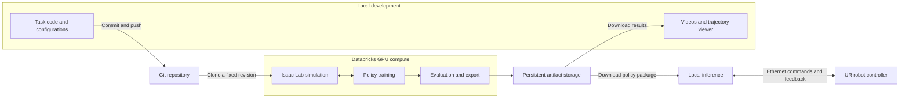
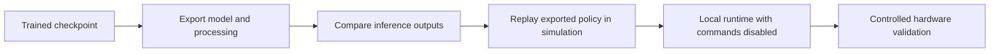
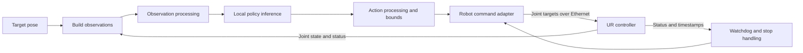

# Benchmarking RL and Model-Based Control for UR Robots

A workflow for developing Universal Robots control tasks locally, training reinforcement learning policies on Databricks with Isaac Lab, and running exported policies on a local computer connected to the robot.

The initial task described here is UR5e reaching. Keep robot-specific models and configurations separate when extending the benchmark to UR7e or other arms.

> **Project status:** This repository currently documents the proposed setup. The task package, training jobs, viewers, and hardware deployment code are planned. Commands are setup examples; Databricks installation and robot deployment have not yet been validated for this project.

## Architecture



Isaac Lab and the GPU training environment live on Databricks. Local development only needs an editor, Git, and the tools used by the project. Robot operation uses a separate local deployment environment; Databricks is outside the physical robot's control loop.

## Recommended starting point

- **Simulation:** Isaac Lab 3.0.0 with Newton/MJWarp, initially without rendering.
- **Learning:** RSL-RL PPO with joint-state observations.
- **First task:** Reach a target using bounded joint-position targets or increments.
- **Execution:** One GPU on a single-node Databricks compute resource.
- **Inspection:** Download recorded evaluation videos before adding live streaming.
- **Deployment:** Export the policy and its processing metadata, then validate local inference.

Isaac Lab 3.0 supports training without the full Isaac Sim application. Add Isaac Sim when the task needs its integrations or rendering stack. [Installation documentation](https://docs.nvidia.com/isaaclab/3.0/isaac-lab/installation)

## Folder layout

These are generic example locations. `workspace/` can be anywhere on a development machine. `project/` is an arbitrary checkout directory name, independent of the repository's public name.

### Development workspace

```text
workspace/
|-- IsaacLab/                         # Optional framework source checkout
`-- project/                          # This repository
    |-- README.md
    |-- .gitignore
    |-- ur_control/                   # Planned installable task package
    |   |-- pyproject.toml            # Dependencies and task registration
    |   |-- uv.lock                   # Reviewed dependency lockfile
    |   |-- src/ur_control/
    |   |   |-- assets/data/ur5e/      # Robot model and small licensed assets
    |   |   `-- tasks/
    |   |       |-- balance/          # Initial generated example
    |   |       `-- reach/
    |   |           |-- mdp/          # Observations, rewards, terminations
    |   |           `-- config/ur5e/  # Scene, actuators, agent configuration
    |   |-- scripts/
    |   `-- tests/
    |-- controllers/                  # Planned model-based controllers
    |-- benchmarks/                   # Planned shared evaluation code
    |-- configs/                      # Planned experiment configurations
    |-- databricks/                   # Planned notebooks and job definitions
    |-- deployment/                   # Planned local runtime and robot adapter
    |-- visualization/                # Planned trajectory replay tools
    `-- results/                      # Small curated reports and plots
```

The task generator supplies the package structure; the UR5e task and the other project directories still need implementation. Keep framework code separate from project code. If source-linked dependencies are used, preserve the relative `IsaacLab/` location or update the dependency paths when moving either checkout.

### Databricks temporary execution space

```text
/local_disk0/ur_rl/
|-- paths.env                         # Local configuration; never commit
|-- bin/                              # uv executable
|-- cache/                            # Download cache
|-- python/                           # Managed Python installation
|-- scaffold/                         # One-time template generation
|-- IsaacLab/
|   |-- .venv/                        # Linux framework environment
|   `-- logs -> persistent runs/framework/logs
`-- project/
    `-- ur_control/
        |-- .venv/                    # Linux project environment
        `-- logs -> persistent runs/ur_control/logs
```

Treat node-local files as disposable. Rebuild them on replacement compute. Code belongs in Git; checkpoints and results belong in persistent storage. A driver-node installation does not automatically install dependencies on worker nodes.

### Persistent artifacts

```text
/Volumes/<catalog>/<schema>/<volume>/ur_rl/
|-- assets/                           # Large robot assets and datasets
|-- runs/
|   |-- framework/logs/               # Installation checks
|   `-- ur_control/logs/              # Checkpoints, run configs, metrics, videos
|-- exports/                          # Complete deployment packages
|-- evaluations/                      # Trajectories and benchmark metrics
`-- videos/                           # Selected evaluation recordings
```

Use an existing Unity Catalog Volume with suitable compute support and access permissions. `/Volumes/...` is the filesystem form used by Python and shell tools. Keep environments and caches on local scratch. [Volume file access](https://docs.databricks.com/aws/en/volumes/volume-files)

## Requirements

### Training with Newton

| Component | Baseline |
|---|---|
| Isaac Lab | Pin `v3.0.0` and record the resolved commit |
| Python | 3.12 in an isolated environment |
| Linux | Supported distribution; inspect the cluster OS |
| GPU | Supported NVIDIA CUDA GPU; default CUDA 13 stack requires Turing or newer |
| NVIDIA Linux driver | At least 580.65.06 for the default stack |
| Memory | Depends on robot complexity and parallel environment count |
| Tools | Git, curl, uv; Git LFS when model assets require it |
| Connectivity | Access to package indexes, source repositories, and required assets |

Standard prebuilt dependencies do not require a separate CUDA Toolkit installation. Check the actual GPU, driver, and Python environment before training. [Isaac Lab requirements](https://docs.nvidia.com/isaaclab/3.0/isaac-lab/installation)

For AWS classic compute, start with a GPU ML runtime, single-node compute, and Photon disabled. Other clouds and compute offerings need equivalent checks. Custom GPU containers depend on workspace support and cannot replace the host's NVIDIA driver. Spark does not automatically distribute the RL training loop. [Databricks GPU compute](https://docs.databricks.com/aws/en/compute/gpu)

### When full Isaac Sim is needed

Isaac Lab 3.0 pairs with Isaac Sim 6.2. Full Isaac Sim has separate graphics and system requirements; current published workstation minimums include 32 GB RAM, 16 GB VRAM, and an RTX 4080. A100/H100 GPUs lack RT cores and are unsupported for Isaac Sim, even headlessly. A supported Newton-only workflow has different requirements. [Isaac Sim requirements](https://docs.isaacsim.omniverse.nvidia.com/latest/installation/requirements.html)

### Local deployment

A separate local Python environment can run an exported model through ONNX Runtime or another compatible inference runtime. CPU inference is a starting point for a small joint-state policy; measure latency and jitter before selecting the policy rate. Local inference does not require the full simulator. [ONNX Runtime Python documentation](https://onnxruntime.ai/docs/get-started/with-python.html)

## Databricks installation

The following are notebook shell cells: keep `%sh` as the first line. Each cell starts a fresh shell, so later cells source `paths.env`. In a terminal, omit `%sh`.

Replace `REPLACE_WITH_PROJECT_GIT_URL` and the volume placeholders with deployment-specific values. Keep credentials in the platform's authentication or secret facilities. Git authentication in a shell may differ from authentication in a Databricks Git folder.

### 1. Inspect the GPU node

```bash
%sh
set -euo pipefail
uname -m
cat /etc/os-release
nvidia-smi
df -h /local_disk0
```

Compare the driver against the requirements above. `nvidia-smi` reports driver CUDA capability, not the CUDA build installed in the project's PyTorch environment.

### 2. Configure generic execution and storage paths

The volume must exist before this step. Creating a directory does not provision a Unity Catalog Volume.

```bash
%sh
set -euo pipefail
mkdir -p /local_disk0/ur_rl
cat > /local_disk0/ur_rl/paths.env <<'ENV'
export UR_RL_ROOT=/local_disk0/ur_rl
export UR_RL_PROJECT="$UR_RL_ROOT/project"
export UR_RL_VOLUME="/Volumes/<catalog>/<schema>/<volume>"
export UR_RL_PERSIST="$UR_RL_VOLUME/ur_rl"
export UV_CACHE_DIR="$UR_RL_ROOT/cache"
export UV_PYTHON_INSTALL_DIR="$UR_RL_ROOT/python"
export PATH="$UR_RL_ROOT/bin:$PATH"
ENV
source /local_disk0/ur_rl/paths.env
test -d "$UR_RL_VOLUME"
mkdir -p "$UR_RL_PERSIST/assets" "$UR_RL_PERSIST/runs/framework/logs" \
  "$UR_RL_PERSIST/runs/ur_control/logs" "$UR_RL_PERSIST/exports" \
  "$UR_RL_PERSIST/evaluations" "$UR_RL_PERSIST/videos"
export UV_INSTALL_DIR="$UR_RL_ROOT/bin"
export UV_NO_MODIFY_PATH=1
curl -LsSf https://astral.sh/uv/install.sh | sh
uv --version
```

Use another supported installation method if workspace policies require it. [uv installation](https://docs.astral.sh/uv/getting-started/installation/)

### 3. Clone fresh checkouts

If the directories already exist, inspect and reuse their revisions instead of cloning over them. Pin the project to a reviewed commit for repeatable experiments.

```bash
%sh
set -euo pipefail
source /local_disk0/ur_rl/paths.env
git clone --branch v3.0.0 --depth 1 \
  https://github.com/isaac-sim/IsaacLab.git "$UR_RL_ROOT/IsaacLab"
git clone REPLACE_WITH_PROJECT_GIT_URL "$UR_RL_PROJECT"
git -C "$UR_RL_ROOT/IsaacLab" rev-parse HEAD
git -C "$UR_RL_PROJECT" rev-parse HEAD
```

Install Git LFS and fetch LFS content if required by the chosen model assets.

### 4. Install and verify the isolated environment

These commands leave the notebook's built-in Python environment intact.

```bash
%sh
set -euo pipefail
source /local_disk0/ur_rl/paths.env
cd "$UR_RL_ROOT/IsaacLab"
uv sync
uv run python - <<'PY'
import sys
import torch
print("Python:", sys.version)
print("PyTorch:", torch.__version__, "CUDA build:", torch.version.cuda)
assert torch.cuda.is_available(), "CUDA is unavailable"
print("GPU:", torch.cuda.get_device_name(0))
print("CUDA allocation:", torch.ones(1, device="cuda"))
PY
uv run isaaclab list_envs --show_presets
```

### 5. Check built-in training and artifact persistence

Create the `logs` link once per fresh checkout. If it already exists, inspect and reuse the correct link or preserve existing data before changing it.

```bash
%sh
set -euo pipefail
source /local_disk0/ur_rl/paths.env
cd "$UR_RL_ROOT/IsaacLab"
ln -s "$UR_RL_PERSIST/runs/framework/logs" logs
uv run isaaclab train --rl_library rsl_rl \
  --task Isaac-Cartpole-Direct --num_envs 16 --max_iterations 10 \
  physics=newton_mjwarp
```

Confirm the run writes a checkpoint to persistent storage. This short check verifies execution, not convergence. Start without rendering. [Training quickstart](https://docs.nvidia.com/isaaclab/isaac-lab/quickstart)

## Create the project package

Perform generation once, only while `project/ur_control/` does not exist. Generate into scratch and copy the files without the generator's nested Git repository. Both locations have the same depth relative to the framework checkout.

```bash
%sh
set -euo pipefail
source /local_disk0/ur_rl/paths.env
test ! -e "$UR_RL_PROJECT/ur_control"
mkdir -p "$UR_RL_ROOT/scaffold"
cd "$UR_RL_ROOT/IsaacLab"
uv run isaaclab --new --non_interactive \
  --project_path "$UR_RL_ROOT/scaffold" \
  --name ur_control --author "Project contributors"
python - <<'PY'
import os
import shutil
from pathlib import Path
root = Path(os.environ["UR_RL_ROOT"])
shutil.copytree(
    root / "scaffold" / "ur_control",
    Path(os.environ["UR_RL_PROJECT"]) / "ur_control",
    ignore=shutil.ignore_patterns(".git", ".venv", "__pycache__"),
)
PY
cd "$UR_RL_PROJECT/ur_control"
uv sync
uv run isaaclab list_envs --show_presets
```

The default template is Cartpole; the UR5e task still needs implementation. Commit the generated project and lockfile through the normal Git workflow before the node is replaced. On later checkouts, skip generation and use `uv sync --locked` from `ur_control/`.

The generator declares task discovery and editable dependency paths. Update `[tool.uv.sources]` if the framework/project relationship changes. [External project documentation](https://docs.nvidia.com/isaaclab/developer-tools/build-your-own-project-or-task)

### Implement the reaching task

1. Add a licensed UR5e model and required meshes. Verify its importer and format work with the selected physics backend.
2. Configure joints, base, tool frame, inertial properties, limits, collisions, actuator behavior, and the initial pose.
3. Define observations available on the real robot, such as joint position, joint velocity, target pose, and previous action. Keep privileged simulator values out of the deployed actor's input contract.
4. Define bounded actions, control rate, targets, rewards, resets, success conditions, and timeouts. Add task registration and a compatible Newton preset.
5. Inspect zero-action and random-action behavior, then run a short PPO check before scaling.
6. Compare RL and model-based methods with shared targets, dynamics, actuator interfaces, episode limits, seeds, and evaluation metrics.

## Train and collect results

Run from the generated project so task discovery uses its installed package. Create its `logs` link once, then substitute the registered task ID from `list_envs`.

```bash
%sh
set -euo pipefail
source /local_disk0/ur_rl/paths.env
cd "$UR_RL_PROJECT/ur_control"
ln -s "$UR_RL_PERSIST/runs/ur_control/logs" logs
uv run isaaclab list_envs --show_presets
```

```bash
%sh
set -euo pipefail
source /local_disk0/ur_rl/paths.env
cd "$UR_RL_PROJECT/ur_control"
UR_RL_TASK=REPLACE_WITH_REGISTERED_TASK_ID
uv run isaaclab train --rl_library rsl_rl \
  --task "$UR_RL_TASK" --num_envs 16 --max_iterations 10 \
  physics=newton_mjwarp
```

Increase the environment count and training budget after validating the task. Set periodic checkpoint saving for long jobs. Check read/write behavior through the volume before relying on it; if a library needs local output, implement periodic uploads rather than copying only after completion.

Record the code revisions, dependency lockfile, robot model revision, backend, GPU/driver, seed, environment count, training settings, and checkpoint identity with each experiment. Suggested metrics include success rate, final pose error, completion time, control latency, and limit violations.

Download artifacts through Catalog Explorer or an authenticated Databricks file API/CLI. Use `results/` for selected public plots and tables; keep raw runs and deployment downloads outside Git. [Working with volume files](https://docs.databricks.com/aws/en/volumes/volume-files)

## Visualize the robot

| Method | Where it runs | Use |
|---|---|---|
| Recorded evaluation video | Render on Databricks; watch locally | First choice for reviewing policy behavior |
| Trajectory replay | Local viewer using model and logged joint positions | Inspect motion, targets, and errors interactively |
| Live viewer | Remote simulation with Viser or another supported viewer | Interactive debugging when network access is configured |

### Record an evaluation

Replay a chosen checkpoint with a small environment count. For Newton, explicitly select Newton GL for capture. The node needs a working EGL/graphics stack; CUDA availability alone does not guarantee rendering works.

```bash
%sh
set -euo pipefail
source /local_disk0/ur_rl/paths.env
cd "$UR_RL_PROJECT/ur_control"
UR_RL_TASK=REPLACE_WITH_REGISTERED_TASK_ID
UR_RL_CHECKPOINT="$UR_RL_PERSIST/runs/ur_control/logs/REPLACE_WITH_RUN/model.pt"
uv run --extra video isaaclab play --rl_library rsl_rl \
  --task "$UR_RL_TASK" --checkpoint "$UR_RL_CHECKPOINT" --num_envs 1 \
  --viz newton_gl --headless --video --video_length 300 \
  physics=newton_mjwarp
```

Check the printed output location; recordings normally live under the run's log directory. Use the actual checkpoint filename and a compatible evaluation task/configuration. [Video recording documentation](https://isaac-sim.github.io/IsaacLab/v3.0.0/source/how-to/record_video.html)

### Replay trajectories locally

A planned lightweight viewer can reconstruct the robot's motion from timestamps and joint angles without running Isaac Lab locally. Log the joint order, robot model revision, target pose, and frame definitions alongside the trajectory. This is kinematic replay; it does not reproduce the training physics.

Live viewers require an authenticated connection supported by the workspace, such as an approved proxy or tunnel. Starting a viewer on a cluster port does not automatically make it accessible from a browser. Viewer and tunnel setup remain to be implemented.

## Export and run the policy locally



Download a complete deployment package rather than weights alone:

| Item | Purpose |
|---|---|
| Exported model | Architecture and learned parameters |
| Input contract | Observation order, units, frames, history, normalization |
| Output contract | Action interpretation, scaling, bounds, default pose |
| Timing and state | Policy rate, previous-action state, recurrent state if used |
| Run metadata | Robot/configuration revisions and evaluated checkpoint |

Isaac Lab's LEAPP export can capture the model together with processing and state metadata. A local adapter still has to supply real sensor inputs, run the exported pipeline correctly, and communicate with the controller. Export is not a ready-made UR robot driver.

```bash
%sh
set -euo pipefail
source /local_disk0/ur_rl/paths.env
cd "$UR_RL_PROJECT/ur_control"
UR_RL_TASK=REPLACE_WITH_REGISTERED_TASK_ID
UR_RL_CHECKPOINT="$UR_RL_PERSIST/runs/ur_control/logs/REPLACE_WITH_RUN/model.pt"
uv run --extra leapp isaaclab leapp export --rl_library rsl_rl \
  --task "$UR_RL_TASK" --checkpoint "$UR_RL_CHECKPOINT" \
  --export_save_path "$UR_RL_PERSIST/exports" \
  physics=newton_mjwarp
```

Inspect the generated artifacts and validation output. Supported export paths depend on task workflow and operations used by the policy. [LEAPP export documentation](https://docs.nvidia.com/isaaclab/3.0/resources/sim-2-real-deployment-of-policies-trained-in-isaac-lab/exporting-policies-with-leapp)

### Physical robot control loop



The local computer reads feedback, constructs the exact training observations, runs inference, and maps the output into the robot's supported command interface. If preprocessing is already in the exported graph, do not apply it twice.

`ur_rtde` provides receive and control interfaces, with a robot-side control script. Match the deployed command type to the action interface used during training. The controller handles servo execution; the external application must still meet the timing requirements of the selected interface. [ur_rtde documentation](https://sdurobotics.gitlab.io/ur_rtde/introduction/introduction.html)

The planned `deployment/` package should contain policy loading, observation construction, command conversion, timing measurements, and disconnect/stale-data handling. Start with commands disabled, then use conservative robot limits and supervised hardware validation. A successful simulation rollout does not establish reliable physical behavior; account for model error, latency, payload, calibration, and actuator differences.

## Public repository conventions

Examples in this guide use generic paths and placeholders. Keep deployment-specific configuration outside tracked files and use environment variables or secret facilities for credentials.

The included `.gitignore` excludes local environments, caches, credentials, logs, and downloaded model outputs. Commit reviewed source code, lockfiles, configuration templates, and selected benchmark reports. Ignore rules do not remove previously tracked content or old Git history; review staged changes before publishing.

Redistribute robot models, meshes, datasets, and exported artifacts only under their applicable licenses. The diagrams in this README are editable Mermaid diagrams rendered directly by GitHub; they do not rely on private image URLs.

## Troubleshooting

| Issue | Check |
|---|---|
| CUDA unavailable | GPU node, host driver, and PyTorch inside the isolated environment |
| Driver too old | Compatible Databricks runtime/compute; installing a CUDA toolkit does not upgrade the host driver |
| Task missing | Working directory, installed package, entry point, imports, registered ID |
| Framework moved | Editable source paths and a freshly recreated environment |
| Rendering fails | EGL/graphics support and explicit capture-capable visualizer |
| Live viewer unreachable | Workspace-supported authentication, routing, and tunnel/proxy configuration |
| Results disappear | Persistent output destination and periodic artifact writes |
| Local policy differs | Joint order, normalization, units, frames, action scale, timing, state |
| Memory exhausted | Reduce parallel environments and disable camera workloads first |

Documentation baseline: Isaac Lab 3.0.0. Verify compatibility again when changing simulator, runtime, GPU, or deployment dependencies.
